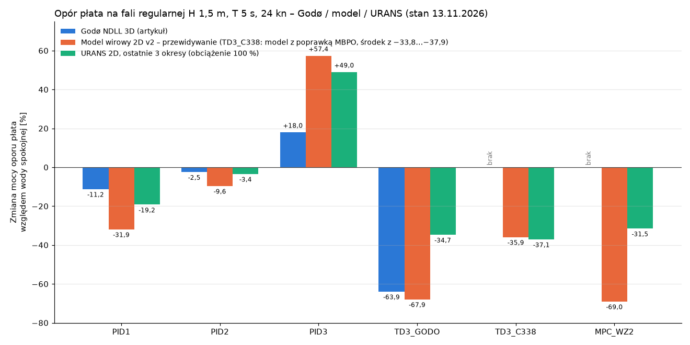
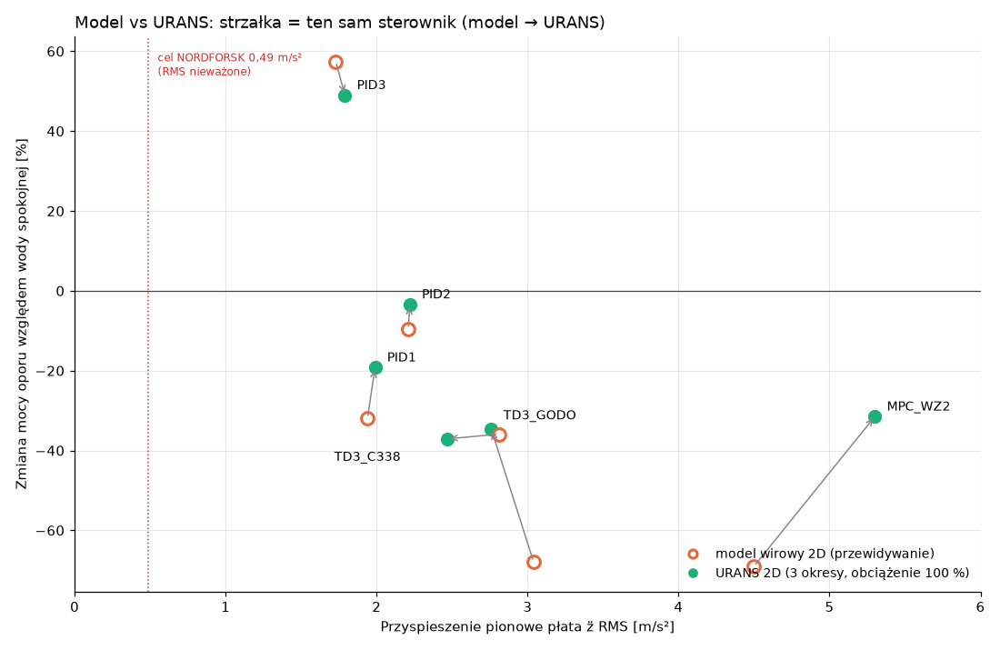

# Raport archiwalny: sterowanie płatem uczone przez wzmacnianie (DRL) i MPC – zamknięcie wątku

Stan: 13.11.2026, 17:50, wersja 2 (agent A + koordynator). Zlecenie: `claude/zlecenie-A-raport-DRL.md`. Kopia w projekcie: `claude/raport-archiwalny-DRL.md`.

> **Status danych.** Wersja 1 (agent A) powstała bez dostępu do laptopa. W wersji 2 koordynator przeliczył na laptopie (tylko odczyt, 13.11 17:40): wszystkie przebiegi URANS z `history.csv` (z usunięciem zdublowanych wierszy po wznowieniach) i oceny wszystkich treningów z `meta.json` / `eval.csv` / `STATUS.json`; sprawdził definicję `P_act_W` w makrze i długość epizodu w `godo_vortex_env.py`. Zarzuty A1–A5 z rozdz. 11 są poprawione w tekście.

## 1. Streszczenie

Odtworzyliśmy w 2D sterowanie kątem płata Godø (TD3) na fali regularnej: trening w szybkim modelu wirowym, sprawdzenie gotowych polityk w URANS (STAR-CCM+, overset, swobodne nurzanie). W modelu wirowym TD3 obiecywał −68 % mocy oporu, MPC −69 %; w URANS dały −34,7 % (TD3_GODO), −37,1 % (TD3_C338) i −31,5 % (MPC), przy obciążeniu 100 %. Błąd modelu rośnie z agresywnością ruchu: PID-y 6–13 punktów, TD3 33 punkty, MPC 37 punktów. Siły przy zadanym ruchu model liczy dobrze (TD3: −2,7…−3,7 % mocy, model Faltinsena E); myli się pętla zamknięta – sterownik znajduje w modelu ruch, którego zysk w URANS się nie powtarza. **Wniosek: model is the bottleneck – sterownik uczony lub optymalizowany w modelu jest tak dobry jak model.** MPC to wynik ujemny: gorszy od TD3_C338 w każdej mierze (z̈ 2,1×, moc siłownika 5×), a przy mocy siłownika liczonej jako moc mechaniczna zysk netto spada do ok. −2 %. Decyzja ze Sverre (13.11): DRL nie rozwijamy; dalej model fizyczny (Faltinsen), zawieszenie, widmo falowe.

## 2. Przypadek

| Wielkość | Wartość |
|---|---|
| Prędkość U | 12,35 m/s (24 kn) |
| Cięciwa c / rozpiętość b / AR | 0,312 m / 7,99 m / 25,6 |
| Zanurzenie projektowe h | 1,09 m (h/c 3,49) |
| Profil | NACA 66₁-012, linia a = 0,8 (mod) |
| Fala | regularna czołowa, H 1,5 m, T 5,0 s, λ 39 m; okres spotkania 1,9368 s (0,516 Hz) |
| Pionowa prędkość wody na płacie | ±0,77 m/s (kąt napływu ±3,6°) |
| Ograniczenia kąta płata | ±7,5°, 90°/s; serwo 2. rzędu ωn 40 rad/s, ζ 1 |
| Obciążenie w URANS | **100 % ciężaru 12,5 t: 122,6 kN, CL 0,642**; pasek 0,02 m, masa 31,3 kg |
| Woda spokojna (odniesienie %) | 61,1 W na pasek 0,02 m (OVS_CALM_PID2) |

Opis: dane z `karta-stalych.md`. **Wszystkie przebiegi URANS w tym raporcie są przy 100 %.** Decyzja Julka z 13.11, 12:16 (główny płat niesie 90 %, CL 0,578, woda spokojna 57,03 W w modelu Faltinsena) dotyczy prac dalszych (porównanie z Godø, Krok 3); liczb tego raportu nie przeliczamy na 90 %.

## 3. Metoda

**Obraz.** Fala daje płatowi pionowy podmuch ±0,77 m/s. Jeśli płat w odpowiednim momencie podniesie nos, siła nośna przechyla się do przodu i część energii fali idzie w ciąg – opór spada. Sterownik ma to robić, nie wyrzucając płata z wody i nie trzęsąc łodzią.

### 3.1 Model wirowy 2D (środowisko treningu)
- Wiry skupione na cięciwie (wir na 1/4 panelu, kolokacja 3/4), swobodny ślad niestacjonarny, powierzchnia swobodna jako odbicie lustrzane, fala Airy'ego, nurzanie z równania ruchu, serwo jak w makrze URANS.
- Walidacja w płynie nieograniczonym: Theodorsen |L| do 1 %, faza do 0,6°; Sears |L| do 2 %; ciąg Garricka 0,99–1,01.
- Wersja v2 (ta, w której trenowano) miała **dopasowania do URANS**: wzmocnienia i opóźnienia `CALIB_CL.json` (6 stałych), biegunowa CD = 0,0104 + 0,0716(CL − 0,642)², ograniczenie CL_MAX ustawione ręcznie, poprawka MBPO.
- Czego nie ma: oderwania (model liniowy, nielepki – przy dużych kątach zawyża siłę), doliny powierzchni nad płatem (ok. −0,15 m przy krawędzi natarcia w URANS), poziomej prędkości fali (dodana dopiero w modelu Faltinsena), momentu względem c/4 (korelacja 0,12–0,28 – moc siłownika z modelu niewiarygodna).
- Na przebiegach PID z URANS: Fx korelacja 0,96–1,00, amplituda −12…+8 %; CL faza dobra, amplituda zawyżona o 23–57 % (`walidacja-model-wirowy-na-przebiegu-pid.md`).

### 3.2 RL: TD3 i SAC
- Specyfikacja wg Godø (Ocean Eng. 312): 5 obserwacji (z, ż, wzniesienie fali, pionowa prędkość wody, poprzednia komenda), akcja = kąt płata; sieci 2×256 ReLU. U Godø takt 80 Hz; **u nas takt sterowania 100 Hz** (co 10 kroków po 1 ms, jak w makrze URANS), epizod 8 okresów spotkania = 8 × 1,9368 s / 0,01 s = **1549 taktów** (+ 1 s rozbiegu przed epizodem, `godo_vortex_env.py`).
- Nasze konfiguracje (`meta.json`): TD3 – lr aktor 2·10⁻⁶, krytyk 2·10⁻⁵, γ 0,999, τ 0,005, opóźnienie aktora 5, szum celu 0,2 (obcięty 0,5), batch 256, 1,4 mln kroków; SAC – lr 3·10⁻⁴ (aktor i krytyk), γ 0,995, 0,6 mln kroków.
- Nagroda: wariant Godø (sprawność We 1,3 + baza Sg 0,5) – TD3_GODO; wariant C338 – dodatkowo opór wspornika 338 N na metr zanurzenia (głębiej = dłuższy wspornik = więcej oporu), polityka dotrenowana raz na skorygowanym modelu. Różnica względem Godø: nasza kara za zanurzenie < 2 cięciwy od chwilowej powierzchni (Godø: c/2 + 0,15 m od średniego poziomu) i zakres ±7,5° liczony od zera, a nie od kąta trymu – dlatego nasza sieć siedzi głębiej i macha słabiej niż Godø. Kąt trymu: w URANS 3,5° (`run.properties`, wszystkie przebiegi); 3,22° to kąt odniesienia PID-ów Godø w ocenie modelu (`eval_v2.py`) – PID-y w modelu i w URANS mają więc trym różny o 0,28°.

### 3.3 MBPO / korekcja modelu
Model v2 łatany regresją ridge reszt (URANS − model) z przebiegów PID („poprawka MBPO”, `mbpo_residual.pkl`; wg `MBPO_NOTE.txt` TD3_R: 5 przebiegów). Treningi z poprawką (TD3_C338, TD3_R, SAC_R) losowały dodatkowo co epizod: skalę CL 0,85–1,15, amplitudę fali 0,9–1,1 i opóźnienie 0–1 takt (odporność na błąd modelu). Julek (13.11): niepokój, że korekty modelu Godø nie robił. Model Faltinsena (Krok 2) usuwa wszystkie te dopasowania.

### 3.4 MPC
Liniowy MPC z modelu wirowego, waga nurzania W_Z = 2; w URANS jako most Python–STAR (makro wywołuje optymalizację co krok sterowania). Przewidywanie w modelu: −69 %, z̈ 4,5 m/s².

### 3.5 Sprzężenie z URANS
Overset, obrót całego płata wokół c/4, swobodne nurzanie (jawne całkowanie m·z̈ = Fy − mg), dt 1 ms, 8 iteracji wewnętrznych, 80 tys. komórek, 16 rdzeni, ok. 1 s/krok. Makro `GodoOversetRun.java` czyta politykę z pliku (sieć 5→256→256→1) i zadaje kąt między krokami; wszystko edytowalne w GUI. Przebieg: 11,62 s = ok. 1 s rozbiegu + 5 swobodnych okresów.

### 3.6 Błąd makra 13.11 (02:06)
Przebiegi `*_BLAD_PIDKp10` **nie są wynikami polityk** i są pominięte. Wpis w `overnight_chain.log` (13.11 02:06): funkcja kompilująca makro nadpisywała kopię makra oryginałem, więc OVS_POL_TD3_GODO i OVS_POL_TD3_C338 liczyły PID z Kp 10 (tryb „policy” nieznany starej wersji makra). Poprawka w `run_policy_ctrl.py` / `run_mpc_ctrl.py`, oba przebiegi policzone ponownie (TD3_GODO do 05:26, TD3_C338 do 10:32). Lekcja: każdy przebieg polityki musi w logu potwierdzić, który sterownik faktycznie zadaje kąt (hash pliku polityki + pierwsze komendy).

## 4. Wyniki W MODELU (model wirowy 2D v2)

| Trening | Algorytm, nagroda, model | Kroki wykonane / plan | Najlepsza ocena: zmiana mocy oporu w modelu [%] | Rozrzut po 4 fazach fali [%] | z̈ RMS w ocenie [m/s²] | Zakres wysokości płata z w ocenie [m] | Stan |
|---|---|---|---|---|---|---|---|
| TD3_GODO | TD3, nagroda Godø, model v2 bez poprawki | 1 401 217 / 1 400 000 | −82,0 (ponowna ocena w modelu v2 przez Krok 1: −67,9) | −81,3 … −82,6 | 3,04 | −0,75 … +0,19 | skończony 12.11; w URANS |
| TD3_C | TD3, nagroda Godø | 1 071 699 / 1 400 000 | −64,6 | −63,9 … −65,4 | 2,40 | −0,61 … +0,23 | zatrzymany 12.11 (podstawa TD3_C338) |
| TD3_C338 | TD3_C dotrenowany: nagroda + opór wspornika 338 N/m, model z poprawką MBPO | 1 271 520 / 1 270 000 | −37,9 (własna najlepsza); ostatnia ocena −33,8 | ostatnia: −33,3 … −34,7 | 2,81 (ostatnia) | −0,65 … +0,20 | skończony 12.11; w URANS |
| TD3_R | TD3, nagroda z wspornikiem, model z poprawką MBPO, losowanie CL/fali/opóźnienia | 1 400 109 / 1 400 000 | −52,6 | −52,1 … −53,3 | 2,31 | −0,59 … +0,12 | skończony 13.11 12:20; nie liczony w URANS |
| SAC_B | SAC, nagroda Godø, model v2 | 601 051 / 600 000 | −70,2 | −69,5 … −70,7 | 2,63 | −0,75 … +0,05 | skończony 11.11; nie w URANS |
| SAC_C | SAC | 600 240 / 600 000 | brak ważnej oceny (ostatnia: −165 %, 1 wynurzenie) | – | 2,02 | −0,75 … +0,01 | skończony, wynik niefizyczny – odrzucony |
| SAC_R | SAC, model z poprawką MBPO, losowanie | 261 587 / 600 000 | brak ważnej oceny (−261 %, 3 wynurzenia w ocenie) | – | 1,76 | −0,76 … +0,03 | zatrzymany 12.11 – niestabilny |
| SAC_A_rozbiezny_blad_alfa | SAC | 108 231 / 600 000 | brak (rozbieżny; ostatnia ocena −247 %, 4 wynurzenia) | – | 2,09 | −0,76 … +0,06 | zatrzymany 11.11 – błąd strojenia temperatury entropii α |
| MPC_IRR, SUSP, BENCH | – | brak plików wyników | – | – | – | – | puste katalogi |
| MPC (W_Z 2) | MPC liniowy z modelu v2 | – | −69 | nie sprawdzone | 4,5 | nie sprawdzone | w URANS |
| Test szumu TD3 | TD3 + filtr 100 ms na pomiarach | – | −53 (bez filtru −68) | – | – | – | 13.11 |

Opis kolumn: „zmiana mocy oporu w modelu” = `D_rel` z oceny treningowej (`meta.json`, `eval.csv`): średnia moc oporu płata w modelu wirowym względem wody spokojnej, 8 okresów spotkania, średnia z 4 faz fali; „rozrzut po fazach” = min…max z 4 faz; z̈ RMS = przyspieszenie pionowe płata w tej ocenie; zakres z = położenie pionowe płata względem projektowego. Ocena jest robiona w środowisku, w którym trenowano (model z poprawką MBPO dla TD3_C338/TD3_R/SAC_R), więc liczby różnych wierszy nie pochodzą z tego samego modelu. Wartości ujemne poniżej −100 % (SAC_C, SAC_R, SAC_A) oznaczają ciąg większy niż opór wody spokojnej przy wynurzeniu – niefizyczne, polityki odrzucone.

**Ciekawostka do sprawdzenia:** TD3_C338 w modelu z poprawką MBPO: −33,8 … −37,9 %; w URANS −37,1 % (3 okresy). To jedyny sterownik, dla którego model przewidział URANS w kilku punktach – ale to model już dopasowany do URANS (poprawka z przebiegów PID), a `D_rel` w nagrodzie z wspornikiem może liczyć inny opór niż `P_drag_W` w URANS (sprawdzić, czy zawiera opór wspornika). Na razie nie traktować jako walidacji.

**Test szumu (13.11).** Pewne jest tylko: w modelu TD3 z filtrem 100 ms na sygnałach wejściowych zysk spadł z −68 % do −53 % (`recenzja-agentow.md`, R3-2). Parametry szumu, która polityka i czy była douczana z filtrem – nie znalazłem w dokumentach. Obraz: 100 ms opóźnienia przy okresie 1,94 s to ok. 19° fazy – sterownik reaguje za późno na podmuch i część zysku znika. Wniosek dla sterowania realnego: sonda fali 1–3 m przed płatem daje 0,05–0,15 s wyprzedzenia, czyli rząd wielkości tego filtru.

## 5. Wyniki W URANS (obciążenie 100 %, odniesienie 61,1 W)

| Sterownik | Zmiana mocy oporu, ostatnie 3 okresy [%] | Zmiana mocy oporu, ostatnie 4 okresy [%] | Zmiana mocy oporu w 5 swobodnych okresach, od najstarszego [%] | z̈ RMS, 3 okresy [m/s²] | Moc siłownika kąta P_act [W na pasek] | Godø NDLL 3D [%] |
|---|---|---|---|---|---|---|
| PID1 | −19,2 | −14,1 | +38,7 / +1,1 / −16,5 / −20,8 / −20,3 | 1,99 | 0,09 | −11,2 |
| PID2 | −3,4 | −4,6 | +73,7 / −8,2 / −6,9 / −3,2 / −0,1 | 2,22 | 0,16 | −2,45 |
| PID3 | +49,0 | +47,5 | +70,2 / +43,0 / +45,9 / +49,0 / +52,1 | 1,79 | 0,61 | +18,0 |
| TD3_GODO | −34,7 | −38,6 | −82,5 / −50,1 / −30,1 / −42,6 / −31,5 | 2,76 | 5,60 | −63,9 (jego sieć) |
| TD3_C338 | −37,1 | −38,7 | −83,9 / −43,5 / −39,4 / −39,1 / −32,9 | 2,47 | 3,38 | – |
| MPC_WZ2 | −31,5 | −37,8 | −8,8 / −56,4 / −47,1 / −36,0 / −11,6 | 5,30 | 17,90 | – |

Opis kolumn: zmiana mocy oporu = średnia `P_drag_W` w oknie względem 61,1 W; liczba główna = ostatnie 3 okresy spotkania (5,81 s), obok ostatnie 4 (7,75 s); kolumna 4 = każdy z 5 swobodnych okresów osobno (pierwszy zawiera jeszcze rozbieg); z̈ = pochodna `v_m_s` po czasie; P_act = średnia `P_act_W` = max(0, −M·ω), czyli dodatnia moc mechaniczna, którą siłownik musi dostarczyć, gdy płyn stawia opór obrotowi (makro `GodoOversetRun.java`, l. 159; bez sprawności serwa, bez odzysku); Godø NDLL 3D = Ocean Eng. 312, tab. 5 (PID, zysk mocy z aktuatorem, znak odwrócony) i s. 11 (TD3, spadek oporu). Źródło: przeliczenie koordynatora z `history.csv` 13.11 17:40, ze zdublowanymi wierszami po wznowieniach usuniętymi (zostaje ostatni wpis dla danej chwili).

**Korekta PID1:** wcześniejsze −18,3 / −18,4 % (karta stałych, runda 4) liczono z `history.csv` zawierającym 47 zdublowanych chwil po wznowieniu; po ich usunięciu −19,2 % (3 okresy), −14,1 % (4 okresy, bez zmian). Różnica 0,8 punktu. Pozostałe przebiegi bez duplikatów – liczby bez zmian. PID1 schodzi najniżej z PID-ów: najmniejsze zanurzenie pod chwilową powierzchnią 0,31 m = 0,99 cięciwy, czyli na granicy zasady ≥ 1 cięciwa (TD3_GODO 0,77 m, TD3_C338 0,68 m, MPC 0,40 m, PID2 0,46 m, PID3 0,40 m).

MPC_WZ2 dodatkowo: z̈ rośnie z okresu na okres 4,09 → 4,74 → 5,10 → 5,33 → 5,47 m/s²; kąt na ograniczniku ±7,5° przez 28,8 % okna; z −0,62…+0,44 m (1,06 m szczyt–szczyt); najmniejsze zanurzenie pod chwilową powierzchnią 0,40 m = 1,3 c (zasada ≥ 1 c spełniona z zapasem 0,09 m). Obraz: MPC nie jedzie po fali, tylko ją „pompuje” i ruch się nie ustala.

**Bilans opór + siłownik (P_act = dodatnia moc mechaniczna siłownika, sprawdzone w makrze):**

| Sterownik | Moc oporu, 3 okresy [W na pasek 0,02 m] | Moc oporu + moc mechaniczna siłownika [W na pasek] | Zmiana bilansu względem wody spokojnej 61,1 W [%] |
|---|---|---|---|
| PID1 | 49,4 | 49,5 | −19,0 |
| PID2 | 59,0 | 59,2 | −3,1 |
| PID3 | 91,1 | 91,7 | +50,0 |
| TD3_GODO | 39,9 | 45,5 | −25,5 |
| TD3_C338 | 38,4 | 41,8 | −31,6 |
| MPC_WZ2 | 41,8 | 59,7 | −2,2 |

Opis: moc oporu = średnia `P_drag_W` (U·Fx); moc siłownika = średnia `P_act_W`. To dolna granica energii siłownika: bez strat serwa (sprawność < 100 %) i bez odzysku przy ujemnej mocy. Dla MPC zysk netto znika (−2,2 %); przy sprawności serwa poniżej 93 % (17,9 W / (61,1 − 41,8) W) bilans MPC jest gorszy niż woda spokojna. Najlepszy w URANS w każdej mierze naraz (opór, opór + siłownik, z̈ wśród sterowników aktywnych) jest TD3_C338.

Rys. 1. Zmiana mocy oporu płata względem wody spokojnej [%]: Godø NDLL 3D (artykuł), nasz model wirowy 2D v2 (przewidywanie), nasz URANS 2D (ostatnie 3 okresy, 100 %). „brak” = nie ma takiej liczby. Rysunki wygenerowane z liczb wersji 2.

## 6. Model vs URANS

| Sterownik | W modelu: zmiana mocy oporu [%] | W URANS: zmiana mocy oporu, 3 okresy [%] | Błąd modelu [punkty %] | W modelu: z̈ RMS [m/s²] | W URANS: z̈ RMS [m/s²] |
|---|---|---|---|---|---|
| PID2 | −9,6 | −3,4 | −6,2 | 2,21 | 2,22 |
| PID3 | +57,4 | +49,0 | +8,4 | 1,73 | 1,79 |
| PID1 | −31,9 | −19,2 | −12,7 | 1,94 | 1,99 |
| TD3_GODO | −67,9 | −34,7 | −33,2 | 3,04 | 2,76 |
| MPC_WZ2 | −69 | −31,5 | −37,5 | 4,5 | 5,30 |
| TD3_C338 (model z poprawką MBPO) | −33,8 … −37,9 | −37,1 | ok. 0 … +3 | 2,81 | 2,47 |

Opis: model = model wirowy 2D v2 w pętli zamkniętej (bez poprawki MBPO; dla TD3_C338 – z poprawką, w której go trenowano, patrz uwaga pod tabelą 4); błąd = model − URANS w punktach procentowych (ujemny = model obiecuje więcej zysku). Uwaga: PID-y w modelu liczone przy trymie 3,22°, w URANS 3,5° (rozdz. 3.2).

**Wzorzec (zarzut C2, R4-1):** im agresywniejszy ruch płata, tym większy błąd: PID-y 6–13 punktów, TD3 33, MPC 37. Przyczyna nie w siłach, tylko w ruchu: przy ruchu zadanym z URANS model Faltinsena E myli moc oporu TD3 o −2,7…−3,7 %, w pętli zamkniętej o −6,6…−22 %, nurzanie TD3 +9…+14 %. Opór na fali to mała różnica dużego ciągu i dużego oporu – kilka procent błędu w ruchu daje dziesiątki punktów w oporze. Optymalizator (TD3, MPC) z definicji szuka miejsc, gdzie model obiecuje najwięcej – czyli tam, gdzie model jest najbardziej optymistyczny.

Rys. 2. Zmiana mocy oporu [%] w funkcji z̈ RMS [m/s²]. Pusty punkt = przewidywanie modelu wirowego 2D v2; pełny = URANS (3 okresy). Strzałka łączy ten sam sterownik. Długość strzałki rośnie z agresywnością. TD3_C338: punkt modelu to model z poprawką MBPO (środek przedziału −33,8…−37,9 %). Czerwona linia: cel NORDFORSK 0,49 m/s² (RMS nieważone).

## 7. Ograniczenia i niepewności

| Nr | Co | Skutek dla liczb URANS |
|---|---|---|
| 1 | 5 swobodnych okresów, przebiegi nieustalone (PID1 dryfuje, MPC: z̈ rośnie) | 3 vs 4 okresy różnią się o 2–6 punktów; rozrzut okres-do-okresu w oknie 3 okresów: PID1 4,3, PID2 6,8, PID3 6,2, TD3_GODO 12,5, TD3_C338 6,5, MPC 35,5 punktu |
| 2 | Obciążenie 100 % (URANS) vs 90 % (decyzja 13.11, dalsze prace) | liczby nieprzenoszalne wprost na Krok 3 ani na porównanie z Godø |
| 3 | **R2-1 otwarty:** dodatek oporu ΔCD ≈ 0,0014 (ok. 34 N/m, ok. 15 % wody spokojnej) widoczny tylko w przebiegach overset; w NWAR (siatka stała) ≈ 0 | **jeśli test OVS_FIX_TRIM (wynik ok. 19:30) pokaże, że to numeryka overset, zyski URANS w tym raporcie są zaniżone o ok. 14 punktów** (34 N/m × 12,35 m/s × 0,02 m = 8,4 W = 13,7 % z 61,1 W; np. TD3_C338 ok. −51 % zamiast −37 %); jeśli ΔCD ≈ 0,0014 też przy płacie nieruchomym – liczby zostają |
| 4 | `P_act_W` = max(0, −M·ω) – sprawdzone w makrze (l. 159): moc mechaniczna, bez sprawności serwa | bilans opór + siłownik (pkt 5) to dolna granica; MPC netto −2,2 % albo gorzej |
| 5 | Sterownik zna dokładnie pionową prędkość wody na płacie (z symulacji) | realnie sonda 0,05–0,15 s przed płatem + szum; test 100 ms: −68 → −53 % w modelu |
| 6 | Fala regularna H 1,5 m, T 5 s (0,52 Hz) zamiast widma | od 14:28 projekt pod widmo S1–S4; fala regularna tylko walidacyjna |
| 7 | 2D, pasek 0,02 m, ρ 1000 kg/m³ | wobec Godø 3D brak wirów końcowych i oporu indukowanego (Krok 1) |

## 8. Wnioski i co dalej

1. **Model jest wąskim gardłem.** Każdy sterownik optymalizowany w modelu (TD3 33 pkt, MPC 37 pkt błędu) traci w URANS ok. połowę zysku (wyjątek do wyjaśnienia: TD3_C338 w modelu z poprawką MBPO, A7). Lepsza sieć nie pomoże, póki model nie odtwarza pętli zamkniętej w ±5 %.
2. **MPC – wynik ujemny.** Przewidywanie −69 % → URANS −31,5 %, z̈ 5,30 m/s², 29 % czasu na ograniczniku, ruch nieustalony; gorszy od TD3_C338 we wszystkich miarach.
3. **Najlepszy realny wynik DRL:** TD3_C338 w URANS −37,1 % (4 okresy −38,7 %), z̈ 2,47 m/s² – przy 100 %, z otwartym R2-1. To 5× więcej niż cel NORDFORSK dla pasażerów 0,49 m/s² i 7× więcej niż zmierzony Jetfoil 0,36 m/s² (obie wartości to RMS nieważone, tak jak nasze z̈ – `metaanaliza-przyspieszen-pionowych.md`; uwaga: fala regularna H 1,5 m to wariancyjnie Hs ≈ 2,1 m, porównanie tylko rzędu wielkości). Duży zysk oporu kupiony trzęsieniem.
4. **Dlaczego zamykamy (Sverre 13.11):** DRL wymaga 1,4 mln kroków w modelu i nie przenosi się do URANS lepiej niż model; Julek woli solidny model fizyczny (gotowy na wszystkie warunki, bez uczenia).
5. **Co przechodzi dalej:** model Faltinsena B/E (Krok 2) jako hydrodynamika; zawieszenie i sterowanie z podziałem pasma (Krok 3, K0/K1); oceny na widmie S1–S4 przy 90 %; każda decyzja „opór przy gładkiej jeździe” potwierdzana w URANS (R3-5).

### Co zachować na dysku (tylko wskazanie – nic nie kasować)

| Co | Gdzie | Po co |
|---|---|---|
| Polityki i checkpointy TD3_GODO, TD3_C338, TD3_R (najlepszy + ostatni) | `40_…\vortex_env\runs\<TRENING>\` | odtworzenie wyników URANS; ewentualny powrót |
| `meta.json`, `eval.csv`, `train_log.csv`, `STATUS.json`, `MBPO_NOTE.txt` wszystkich treningów | jw. | konfiguracje i krzywe uczenia |
| Pliki polityk faktycznie użyte w URANS + `history.csv`, `RUN_RESULT.json`, `run.properties`, kopia makra | `70_godo_case\overset_runs\OVS_PID1/2/3_GODO`, `OVS_POL_TD3_GODO`, `OVS_POL_TD3_C338`, `OVS_MPC_WZ2` | dane tego raportu |
| `*_BLAD_PIDKp10` | `overset_runs` | tylko jako dowód błędu makra; nie wynik |
| SAC_A_rozbiezny_blad_alfa, SAC_*, TD3_C, MPC_IRR | `runs\` | kandydaci do odchudzenia (pośrednie checkpointy) – decyzja Julka, po hashu (zasada F1) |

## 9. Rozbieżności z wcześniejszymi liczbami

| Przebieg | Wcześniej (dokument) | Teraz (przeliczenie 13.11 17:40) | Przyczyna |
|---|---|---|---|
| PID1, 3 okresy | −18,3 (karta stałych), −18,4 (runda 4), −18,5 (Krok 1) | −19,2 | 47 zdublowanych chwil w `history.csv` po wznowieniu; teraz usunięte |
| PID1, 4 okresy | −13,6 (runda 4), −14,1 (karta) | −14,1 | jw. |
| PID2, 3 okresy | −3,3 (handoff), −3,5 (Krok 1, odniesienie 61,2 W) | −3,4 | zaokrąglenie / odniesienie 61,1 vs 61,2 W |
| PID3, 3 okresy | +49 (handoff), +48,9 (Krok 1) | +49,0 | jw. |
| TD3_GODO z̈ RMS | 2,74 (handoff) | 2,76 | pochodna liczona na innym wycinku |
| TD3_GODO w modelu | −67,9 (Krok 1, model v2) | −82,0 (ocena treningowa) | inne środowisko oceny; obie liczby w tabeli 4 |

Opis: wszystkie wartości to zmiana mocy oporu płata względem wody spokojnej [%], URANS przy obciążeniu 100 %, chyba że napisano inaczej. Do karty stałych do poprawienia: PID1 −19,2 % (3 okresy).

## 10. Pliki

| Plik | Gdzie |
|---|---|
| ten raport | projekt `claude/raport-archiwalny-DRL.md`; dysk `T:\NTNU_GODO_CONTROL_20261109\90_ARCHIWUM\DRL_2026-11-13\RAPORT_ARCHIWALNY_DRL_2026-11-13.md` |
| Rys. 1–2 (PNG) | jw. na dysku |

## 11. Recenzja koordynatora i stan zarzutów

| Nr | Zarzut (wersja 1, 15:30) | Stan (wersja 2, 17:50) |
|---|---|---|
| A1 | brak przeliczenia z danych; tabela 4 pusta | naprawione: tabele 4–5 z laptopa |
| A2 | epizod 8 okresów = 1239 kroków przy 80 Hz | naprawione: u nas 100 Hz, 1549 taktów (`godo_vortex_env.py`) |
| A3 | trym 3,22° vs 3,5° | naprawione: 3,5° URANS, 3,22° tylko PID-y Godø w modelu |
| A4 | z̈ nieważone vs próg ważony Wk | naprawione: porównanie z 0,49 m/s² NORDFORSK (też nieważone) i Jetfoilem; próg komfortu w projekcie do decyzji Julka (runda 5, M3) |
| A5 | definicja `P_act_W` | naprawione: max(0, −M·ω), dolna granica |
| A6 | R2-1 – przesunięcie zależy od tego, czy woda spokojna ma dodatek | otwarte – wynik OVS_FIX_TRIM ok. 19:30 |
| A7 (nowy) | TD3_C338: model z poprawką ≈ URANS – czy `D_rel` liczy ten sam opór (z wspornikiem?) | otwarte |

## 12. Wyniki URANS po zamknięciu (13–14.11)

Obraz: dwa testy, które miały rozstrzygnąć, czy liczby URANS w tym raporcie są uczciwe. (1) Płat nieruchomy w tej samej fali: czy dodatek oporu ΔCD robi ruch płata i siatki? (2) Woda spokojna na innych głębokościach: czy odniesienie 61,1 W pasuje do sterowników, które jeżdżą głębiej?

| Przebieg URANS (obciążenie 100 %) | Co sprawdza | Moc oporu [W na pasek 0,02 m] | Wynik |
|---|---|---|---|
| OVS_FIX_TRIM – płat nieruchomy, kąt 3,5°, z = 0, fala H 1,5 m T 5 s | R2-1: czy dodatek oporu robi ruch | 17,96 (ostatnie 3 okresy); 17,36 (4 okresy) | Fx 72,7 N/m wobec 37,8 N/m w modelu Faltinsena B → ΔCD = +0,0015 (0,0011–0,0017). Dodatek jest także bez ruchu → **ruch płata i siatki overset wykluczony** |
| OVS_CALM_PID2 – woda spokojna, z = 0 | odniesienie | 61,1 | jak dotąd (przebieg tylko 4 s) |
| OVS_CALM_Z-0.3 – woda spokojna, z = −0,3 m | zależność od głębokości | 62,64 (5–8 s; 62,2 → 63,05) | +2,5 % względem 61,1 W |
| OVS_CALM_Z-0.6 – woda spokojna, z = −0,6 m | zależność od głębokości | 63,50 (5–8 s; 62,7 → 64,3) | +3,9 % względem 61,1 W |

Opis kolumn: moc oporu = średnia `P_drag_W` w podanym oknie, w nawiasie średnie z pierwszej i drugiej połowy okna (dryf). ΔCD = (Fx URANS − Fx model) / (q·c), q·c = 23 783 N/m.

Przeliczenie sterowników względem wody spokojnej na ich średniej głębokości (interpolacja liniowa między z = 0, −0,3 i −0,6 m):

| Sterownik (URANS, ostatnie 3 okresy) | Średnia wysokość płata z [m] | Woda spokojna na tej głębokości [W] | Moc oporu [W] | Zmiana względem 61,1 W [%] | Zmiana względem wody spokojnej na tej głębokości [%] |
|---|---|---|---|---|---|
| TD3_GODO | −0,44 | 63,0 | 39,88 | −34,7 | −36,7 |
| TD3_C338 | −0,38 | 62,9 | 38,41 | −37,1 | −38,9 |
| MPC_WZ2 | −0,20 | 62,1 | 41,84 | −31,5 | −32,6 |

Opis: z = wysokość płata względem projektowej (− = głębiej). Przesunięcie 1–2 punkty – w granicach rozrzutu okres-do-okresu (6–35 pkt), więc wnioski raportu bez zmian.

Nowe zastrzeżenie (R-9.1): **opór w URANS dryfuje w czasie także bez fali** – w wodzie spokojnej o ok. 1,4–2,6 % w ciągu 1,5 s (−0,3 m: 62,2 → 63,05 W; −0,6 m: 62,7 → 64,3 W), w płacie nieruchomym na fali ok. 7 % na okres. To ten sam kierunek co ΔCD. Dopóki przyczyna (powierzchnia swobodna, siatka, krok czasu) nie jest znana, liczby URANS ze swobodnych 5 okresów mają dodatkową niepewność rzędu kilku procent.

Stan zarzutów po 14.11: **A6 / R2-1** – ruch wykluczony; otwarte: układ siatki / Re / fizyka (model B i Godø zgadzają się bez dodatku – przesłanka, że to układ URANS). **A7** – zamknięty przez C: `D_rel` TD3_C338 nie zawiera wspornika, definicja ta sama co `P_drag_W`; zgodność model z poprawką MBPO −33,8…−37,9 % z URANS −37,1 % jest prawdziwa (w modelu dopasowanym do URANS).
